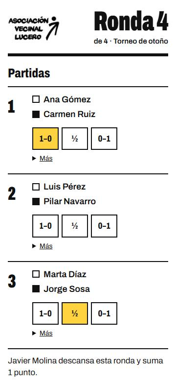

<p align="center">
  
</p>

# Torneo de ajedrez · Asociación Vecinal Lucero

Aplicación web para organizar torneos de ajedrez por **sistema suizo**. Se hizo para los torneos de la Asociación Vecinal Lucero: la usa una sola persona, el organizador, desde el móvil o el portátil el mismo día del torneo.

**Demo:** <https://alejandrodavidmartino.github.io/torneo-ajedrez/>

<p align="center">
  
</p>

## Qué hace

- **Inscripción** de jugadores con nombre y ELO (el ELO es opcional) y elección del número de rondas.
- **Emparejamientos automáticos** por sistema suizo en cada ronda. Nunca se repite rival y los colores quedan equilibrados.
- **Resultados con un toque**: 1–0, ½ o 0–1, e incomparecencias.
- **Clasificación en directo** con desempates Buchholz y Sonneborn-Berger.
- **Descanso** automático cuando hay un número impar de jugadores. Vale 1 punto y nadie descansa dos veces.
- **Retirar y reactivar** jugadores a mitad del torneo.
- **Corrección de errores**: se puede corregir un resultado de una ronda ya cerrada, y la clasificación se recalcula sola. También se puede deshacer la última ronda si aún no tiene resultados.
- **Funciona sin internet**. Es una PWA que se puede instalar en el móvil.
- **Guardado automático** en el propio aparato. También permite descargar y cargar una copia en JSON para pasar el torneo a otro dispositivo.
- **Impresión** de los emparejamientos y la clasificación para colgarlos en la pared.
- **Coste cero**: no usa servidor ni base de datos. Está alojada en GitHub Pages.

## Cómo funciona el emparejamiento

- **Ronda 1.** Los jugadores se ordenan por ELO. Los que no tienen ELO van al final, por orden de inscripción. Después, la mitad de arriba juega contra la de abajo (1.º contra n/2+1, etc.). El color de la primera mesa se sortea y luego se alterna de mesa en mesa.
- **Rondas siguientes.** Se agrupa a los jugadores por puntos y, dentro de cada grupo, la mitad de arriba juega contra la de abajo. El algoritmo es una **búsqueda con vuelta atrás exhaustiva**: si existe un emparejamiento válido, lo encuentra.
- **Reglas que siempre se cumplen:**
  - nunca se repite rival;
  - nadie descansa dos veces.
- **Reglas de color:**
  - ningún jugador acumula más de una partida de diferencia entre blancas y negras;
  - nadie juega tres partidas seguidas con el mismo color.

  Si no hay forma de cumplirlas, se relajan las de color, nunca la de no repetir rival.
- **Sin emparejamiento posible.** Si no queda ninguna combinación sin repetir rival, la app lo explica y ofrece terminar el torneo en esa ronda.

### Desempates

1. Puntos.
2. **Buchholz**: suma de los puntos de los rivales.
3. **Sonneborn-Berger**: puntos de los rivales a los que ganaste, más la mitad de los de aquellos con los que hiciste tablas.
4. ELO.
5. Orden de inscripción.

Los descansos y las incomparecencias no cuentan como partida jugada: no suman color, no cuentan como rival y aportan 0 a los desempates.

## Tecnología

- [Preact](https://preactjs.com/) + TypeScript (modo estricto) + [Vite](https://vite.dev/).
- La lógica del torneo es TypeScript puro e independiente de la interfaz (`src/torneo/`). Las acciones son funciones inmutables, y los puntos y desempates se calculan siempre a partir de las rondas, nunca se acumulan.
- [vite-plugin-pwa](https://vite-pwa-org.netlify.app/) para funcionar sin conexión. La fuente Archivo va autoalojada.
- [Vitest](https://vitest.dev/), [Testing Library](https://testing-library.com/) y [fast-check](https://fast-check.dev/) para las pruebas.
- GitHub Actions: pruebas en cada push y despliegue automático a GitHub Pages desde `main`.

```
src/
  torneo/      tipos, cálculos, emparejamiento, acciones y copia de seguridad
  ui/          pantallas (Preact) y estilos
  almacen.ts   guardado en el navegador
tests/         pruebas de la lógica y de la interfaz
```

## Desarrollo

Necesitas Node 26 o superior.

```bash
npm install
npm run dev      # servidor de desarrollo
npm test         # pruebas
npm run build    # versión de producción en dist/
```

## Pruebas

Hay más de 80 pruebas automáticas:

- **Lógica:** clasificación, desempates, emparejamiento, validaciones, correcciones y copia de seguridad.
- **Pruebas de propiedades** con fast-check: se simulan cientos de torneos al azar, de 4 a 24 jugadores y con resultados aleatorios, y se comprueba que:
  - nunca se repite rival;
  - todos juegan o descansan exactamente una vez por ronda;
  - nadie descansa dos veces;
  - los colores quedan equilibrados.
- **Interfaz:** flujos completos con Testing Library, por ejemplo inscribir jugadores, apuntar resultados, pasar de ronda, retirar jugadores o cargar una copia dañada.
- **Rendimiento:** un torneo de 40 jugadores y 9 rondas se empareja en menos de 2 segundos.

## Licencia

[MIT](LICENSE)
